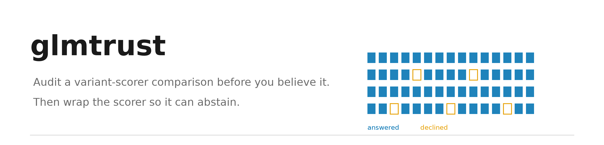
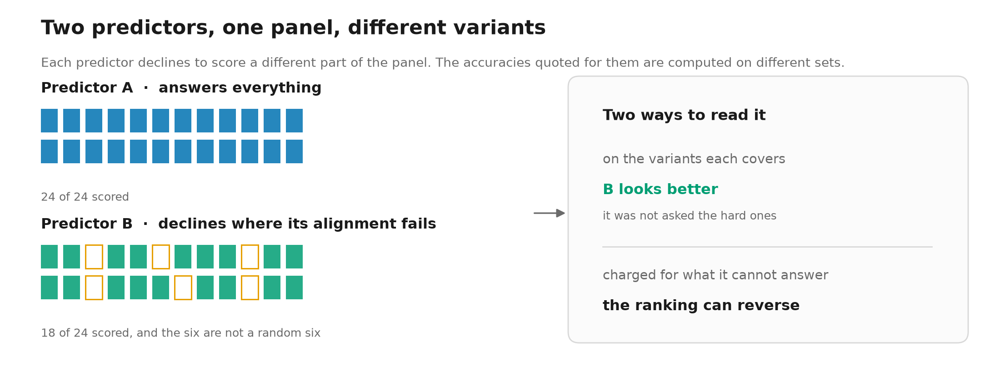

# glmtrust

[](glmtrust/tests)
[](LICENSE)
[](https://www.python.org/)
[](https://colab.research.google.com/github/asediya/evo2-reliability-atlas/blob/main/notebooks/quickstart.ipynb)

Varunkumar Asediya, Udayaraja GK, Haja N. Kadarmideen and Chandra S. Pareek

**Audit a variant-scorer comparison before you believe it. Then wrap the scorer so it can abstain.**

Two variant effect predictors are rarely evaluated on the same variants, because each declines to
score a different part of the panel. The accuracies quoted for them are then computed on different
sets and read as a ranking. `glmtrust` measures that, and gives you a scorer that says "I don't
know" instead of guessing.




> **One code base, two copies.** The project home page,
> `https://github.com/asediya/evo2-reliability-atlas`, and the article's Additional file 2 hold
> identical code, under the MIT License. The Zenodo record `10.5281/zenodo.22046811` mirrors the
> article's Additional files 2 to 6. The article is *Unscored variants leave many comparisons of variant effect predictors undecided: evidence from ClinVar, published benchmarks and genomic language models*, and glmtrust is registered as RRID:SCR_029089.

`reports/DATA_MANIFEST.md` inventories the `data/` paths the code names, gives the raw inputs'
public sources by category and lists the deposited inputs no script writes; `check_manifest.py` verifies every shipped file against `MANIFEST.sha256`.

## Install

```bash
pip install './glmtrust[io]'   # writes glmtrust/build/ and glmtrust/src/glmtrust.egg-info/ into this folder; run check_manifest.py first
```

glmtrust needs Python 3.9+, numpy, scipy and scikit-learn; the analysis layer (src/, analyses/) was run under
Python 3.12. The `[io]` extra adds polars for parquet input. No GPU,
no model weights, nothing to download.

## Audit a comparison

```python
from glmtrust import Scorer, audit

report = audit(labels, [
    Scorer("scorer_a", a, readout="per-substitution score"),
    Scorer("scorer_b", b, readout="per-substitution score"),   # NaN where it declines
])
print(report)
```

For each scorer it reports how much of the panel it reaches, whether that reach differs by class,
its accuracy on the variants it covers, and its accuracy when every variant must be answered. A
scorer that declines the hard cases looks better on the first number and worse on the second.

## The trust layer

```python
from glmtrust import TrustLayer

layer = TrustLayer(calibration="isotonic", conformal="mondrian", alpha=0.10, coverage=0.85)
report = layer.fit(scores, labels).evaluate(scores, labels, groups=species)
out = layer.predict(new_scores)      # probability, prediction set, answer-or-abstain
```

Abstention suppresses false alarms far better than it catches missed positives, so it should not be
used as a screen for missed positives.

## Notebook

**[notebooks/quickstart.ipynb](notebooks/quickstart.ipynb)** runs the audit and the trust layer on a fixture that
ships with the package, 11,109 variants across nine species, with no data of your own.

To run it with nothing installed, open it in Google Colab from the badge above; its first cell installs
`glmtrust`. To run it locally, and to run the package's tests, see [docs/REPRODUCING.md](docs/REPRODUCING.md).

To reproduce the published trust-layer numbers from that fixture, see [docs/REPRODUCING.md](docs/REPRODUCING.md),
Tier 1.

## Analysis code

`src/`, `tools/` and `analyses/scripts/` hold the analysis this tool came out of, and
`reports/` and `analyses/results/` hold the recompute layer. `glmtrust` does not need them; `container/` holds
the recipe of the container the Evo 2 scores were produced in.

**[docs/REPRODUCING.md](docs/REPRODUCING.md)** gives what regenerates from a clone, what needs the
raw data tree, which code and scores are not deposited, and where the guarantees stop.

## Licence

MIT, see [LICENSE](LICENSE). The data files are CC0 1.0 except the third-party parts that
[LICENSING.md](LICENSING.md) lists file by file, some of them PigGTEx's, under CC BY-NC 4.0.

This repository calls Evo 2 (Arc Institute, Apache 2.0) and redistributes none of its source.

`glmtrust/CITATION.cff` carries the software's citation metadata; cite the article itself from its journal record.
