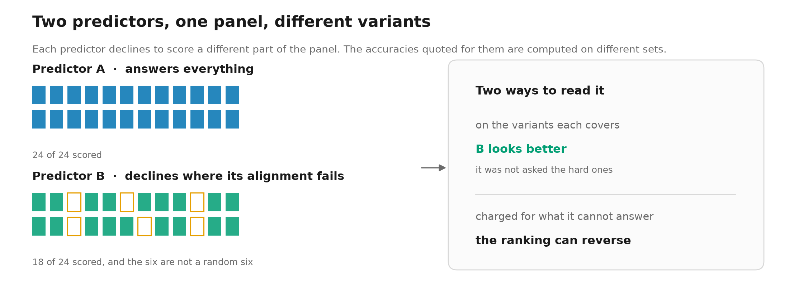

# glmtrust

[](glmtrust/tests)
[](LICENSE)
[](https://www.python.org/)

**Put coverage, reach, and uncertainty back into your variant-prediction results.**

Variant-effect scorers often do not answer every variant. One scorer may cover the easy cases,
another the alignment-rich ones, and a headline AUROC can compare two different panels. `glmtrust`
helps you see exactly what changed—and whether the apparent winner still wins on shared variants.

It also turns a genomic score into calibrated probabilities, conformal prediction sets, and
calls that know when to abstain.



Varunkumar Asediya, Udayaraja GK, Haja N. Kadarmideen, and Chandra S. Pareek

**RRID:** SCR_029089

**Paper:** *Unscored variants leave many comparisons of variant effect predictors undecided:
evidence from ClinVar, published benchmarks and genomic language models*

## Install

```bash
pip install './glmtrust[io]'
```

You will need Python 3.9+ plus NumPy, SciPy, and scikit-learn. The `[io]` extra adds Polars for
CSV, TSV, and Parquet files.

## Audit a comparison

Have a score column for each predictor, and use `NaN` wherever a predictor declines to score a
variant.

```python
from glmtrust import Scorer, audit

report = audit(labels, [
    Scorer("scorer_a", scores_a, readout="per-substitution score"),
    Scorer("scorer_b", scores_b, readout="per-substitution score"),
])

print(report)
```

You get a practical picture of:

- **Reach** — how much of the panel each scorer can answer;
- **Outcome gaps** — whether reach differs for positive and negative labels;
- **Covered AUROC** — performance on only the variants reached;
- **Whole-panel AUROC** — how coverage conventions affect the result;
- **Matched comparisons** — how scorers perform on the variants both reach;
- **Composition effects** — whether class differences survive stratification.

If higher scores mean *more benign*, declare that once:

```python
Scorer(
    "scorer",
    scores,
    readout="per-substitution score",
    higher_is_worse=False,
)
```

## Build a trust layer

```python
from glmtrust import TrustLayer

layer = TrustLayer(
    calibration="isotonic",
    conformal="mondrian",
    alpha=0.10,
    coverage=0.85,
)

report = layer.fit(scores, labels).evaluate(
    scores,
    labels,
    groups=species,
)

output = layer.predict(new_scores)
```

`output` includes calibrated probabilities, conformal prediction sets, conformal decisions,
and selective decisions (`0`, `1`, or `ABSTAIN`). It is ideal for precision-oriented workflows,
but abstention does not reliably catch every missed deleterious variant.

> **Important:** conformal coverage and precision guarantees depend on exchangeability. A
> cross-species deployment should be treated as a calibrated ordering with a selective operating
> point—not as an assumption that one population will behave exactly like another.

## Prefer the terminal?

```bash
glmtrust audit variants.parquet --label-col label --auto --card audit.html
glmtrust evaluate variants.parquet --score-col evo2 --label-col label --group-col species
glmtrust calibrate variants.csv --score-col evo2 --label-col label --out probabilities.csv
glmtrust transfer variants.parquet --score-col evo2 --label-col label --group-col species \
  --out probabilities.csv
```

The CLI accepts CSV, TSV, TXT, gzipped text, and Parquet. Labels should be `0`/`1`, or you can
map text labels explicitly. Missing score cells mean “not scored”; infinite values are rejected.

## Try it yourself

Run the package benchmark:

```bash
PYTHONPATH=glmtrust/src python glmtrust/benchmarks/reproduce_paper_trust_layer.py
```

Run the package tests:

```bash
cd glmtrust
PYTHONPATH=src python -m pytest -q
```

Need the full reproducibility story? Start here:

- [Reproducibility guide](docs/REPRODUCING.md)
- [Package API](glmtrust/docs/api.md)
- [Figure-to-script map](FIGURES.md)
- [Data manifest](reports/DATA_MANIFEST.md)

## What's inside

- `glmtrust/` — installable package, benchmarks, tests, and docs;
- `src/` and `analyses/scripts/` — recomputation and figure-generation code;
- `reports/` and `analyses/results/` — deposited recomputation outputs;
- `tools/` — verification and manifest utilities;
- `container/` — Evo 2 scoring environment definition.

`check_manifest.py` verifies the shipped repository against `MANIFEST.sha256`.
`reports/DATA_MANIFEST.md` documents raw-input sources and deposited inputs.

## Citation and licensing

The code is MIT licensed. Deposited data are CC0 1.0 except third-party components listed in
[LICENSING.md](LICENSING.md); some PigGTEx components are CC BY-NC 4.0.

This repository uses Evo 2 (Apache 2.0) but does not redistribute Evo 2 source.
Use [`glmtrust/CITATION.cff`](glmtrust/CITATION.cff) for software metadata, and cite the article
itself for the scientific study.
